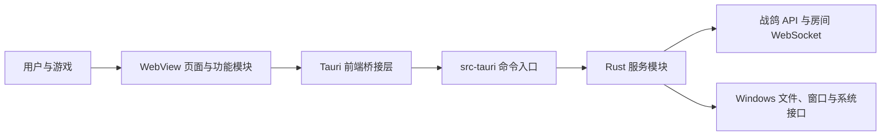

# zhange-app 架构与稳定性约定

本文描述 `zhange-app` 当前的运行边界和后续演进规则。App 与 `zhange-stats` 是独立仓库；本文不把 Stats 的业务或构建职责并入桌面端。

## 运行结构

WebView 负责页面展示、交互和短期 UI 状态。Rust 命令负责本地系统访问、会话密钥保存、游戏日志与截图监控，以及需要由桌面端控制的网络通信。页面不直接读取游戏文件，也不在浏览器端保存访问令牌。

## 模块职责

### 前端

- `src/main.ts` 是应用组合入口，负责顶层路由、页面装配和跨页面协调。它目前也承担较多房间和全局状态逻辑；新增功能不要继续把页面实现和领域状态塞进该文件，稳定后按下方路线逐步拆分。
- `src/routePath.ts` 统一处理浏览器路径解码和酒馆路由匹配。路由守卫必须使用同一套规范化规则。
- 功能模块负责各自页面的视图、事件和生命周期。例如 `liveMap.ts`、`mapPicker.ts`、`lobby.ts`、`taskFlow.ts`、`tavern.ts`、`itemCatalog.ts`、`logSync.ts`。
- 实时地图的自定义地点目前只读展示。App 原有的地点写入处理没有可达 UI 入口，也没有明确的用户权限契约；因此不提供创建、拖动或删除入口。若将来需要编辑，先确认服务端授权和审计行为，再作为独立功能实现。
- 功能模块通过明确函数或事件与应用入口交换状态，不直接修改其他模块的内部可变状态。跨页面状态由应用协调器或独立服务持有。
- `src/styles.css` 只维护 App 页面布局和交互行为。Tarkov 共用视觉令牌、字体和基础控件来自 `vendor/zhange-base/design-system`；页面根节点使用 `.zhange-theme-tarkov`。不要把共享令牌或控件规则复制进本仓库。
- 远程文本进入 DOM 前必须按纯文本转义；允许富文本时使用明确的元素、属性、协议和主机白名单。地图 SVG 在插入 DOM 前先经过净化，并限制源大小、节点数和嵌套深度。不能把未经校验的数据拼进 HTML、CSS、URL 或命令路径。

### Tauri 与 Rust

- 前端只通过 `src/tauriBridge.ts` 调用 Tauri IPC，由该层统一调用机制和非 Tauri 环境错误语义；功能模块不访问 `window.__TAURI_INTERNALS__`。调用点保留每个命令的参数和返回类型，Rust 端负责运行时验证。当前通用 `site_*` 命令的路径和值类型仍较宽松，是后续收紧的架构债务。
- `src-tauri/src/lib.rs` 注册 Tauri 命令并做输入/输出转换。文件、网络、会话、游戏监控和窗口行为分别放在对应服务模块中；避免把系统逻辑写回命令入口。
- `site.rs` 管理战鸽 API、登录会话和认证失效；`room_ws.rs` 管理房间连接；`local.rs` 管理本机路径与日志访问；`logwatch.rs` 解析游戏日志；`shotwatch.rs` 管理截图状态；`overlay.rs` 管理覆盖层；`miaomiao.rs` 管理妙妙工具；`persist.rs` 管理受保护的本地持久化。
- Tauri capability 按窗口拆分。主窗口与地图覆盖层只获得各自需要的命令权限，不用全局通配权限解决单个功能问题。

### 共享基础仓

- `zhange-base` 是 App 与 Stats 共用基础代码的唯一来源，通过 `vendor/zhange-base` Git 子模块接入；子模块提交指针固定消费者使用的版本。
- 当前基础仓中的 `design-system/` 提供框架无关的 Tarkov 令牌、主题 CSS、字体入口、基础控件和许可证。令牌源是 `design-system/tokens/tarkov.json`；生成文件只能通过 `node vendor/zhange-base/design-system/scripts/generate-tokens.mjs` 更新。
- Vite 与 TypeScript 使用 `@zhange-base` 指向子模块源码。消费者直接声明 `fonts.css` 使用的 Fontsource 依赖；共享视觉实现不通过 npm 包分发。
- 首次克隆使用 `git clone --recurse-submodules`，已有检出运行 `git submodule update --init --recursive`。CI 必须初始化子模块，构建不依赖同级目录。

## 必须保持的行为不变量

1. **会话失效会完整清理。** 认证失效后清除并持久化本机会话，关闭房间 WebSocket，并通知前端清空房间成员、位置和地图状态。页面不得依赖一次启动时读取的登录快照继续执行授权操作。
2. **异步结果绑定发起上下文。** 地图、路由、账号、房间或连接切换后，旧请求不得覆盖新页面状态。请求应捕获页面/房间身份或代次，并在完成、失败和 `finally` 更新前检查仍然有效；可取消的请求使用 `AbortController`。
3. **房间消息受身份和格式约束。** 连接按房间身份与代次管理；重连或离房时丢弃旧连接事件。Rust IPC 只允许 `view_map`、`log_phase`、`player_fix` 三种客户端事件，逐字段校验后重新组装消息；截图消息只发送坐标和文件名，不传原图、日志原文、账号密钥或本机路径。
4. **本机敏感数据留在本机。** 游戏日志原文、截图目录和登录密钥不上传。需要保存的会话密钥使用 Windows DPAPI 保护并以原子写入更新；远程同步只发送经过解析的最小状态。
5. **本地资源访问有限界。** 文件读取须限制在用户选择或系统解析得到的允许目录中，并设置文件数、单文件大小和总读取量上限。外部 API 路径、房间 ID、URL、SVG 和地图列表都必须验证格式与大小。
6. **页面模块有明确生命周期。** 每次挂载都要有对应的清理路径，移除窗口事件、定时器、WebSocket 订阅和地图实例；页面卸载后异步任务不能再写入 DOM。
7. **共享视觉规则只有一个来源。** Tarkov 颜色、字体、基础控件由 `zhange-base` 提供；App 自己维护布局和页面行为，保留键盘、焦点、禁用和错误等可访问状态。

## 新功能开发流程

1. 先确定功能属于 WebView 交互、Rust 本地服务还是两者之间的协议，并将它放入相应模块。
2. IPC 命令使用明确参数和返回类型。不要把 `serde_json::Value` 或泛型前端返回类型当作运行时验证；边界数据需校验必填字段、范围和大小。
3. 新增状态转换时优先抽出无 DOM、无 Tauri 依赖的纯函数，并为竞态、边界值和错误路径添加单元测试。
4. 异步操作标明其所有者与取消/失效条件；事件监听、计时器、地图和 socket 在卸载时清理。
5. 样式先检查基础仓是否已有令牌或控件；避免在 App 中引入同名视觉基础规则。
6. 文档要说明功能入口、本机数据边界和恢复行为，尤其是登录、房间连接、游戏监控和文件访问。

## 格式化与测试质量

- 支持的文本文件使用仓库根 `.prettierrc.json` 和 `.prettierignore`；Rust 使用 stable `rustfmt`，Python 由 Stats 仓的 Ruff 格式化。子模块、生成物、锁文件和地图数据不做格式化。
- 测试以可观察行为、边界和状态竞态为单位。一个测试聚焦一种失败原因；断言具体错误契约，不锁定内部成员是否存在；异步等待必须有界。
- 优先测试安全边界、失败恢复与上下文切换。不要为常量/getter 增加测试，不要在多个层重复验证同一规则，也不要为缩短测试文件而删除有意义的场景。
- 当一个测试套件同时覆盖多个 owner 或行为域、修改时难以理解，应按公开行为拆分文件并保留覆盖；不设硬行数门槛。

## 验证与发布

- 前端：`npm test`、`npm run build`。
- 前端格式：`npm run format:check`；Rust 格式：`cargo fmt --manifest-path src-tauri/Cargo.toml --all -- --check`。
- Rust：`cargo test --target i686-pc-windows-msvc --manifest-path src-tauri/Cargo.toml`。
- 依赖：提交前检查 `npm audit`；生产依赖另用 `npm audit --omit=dev` 确认。
- 工作区：检查 `git diff --check`，保留不属于当前任务的已有改动。
- 发布流程只从与 `src-tauri/tauri.conf.json` 版本号一致的 `vMAJOR.MINOR.PATCH` 标签发布；推送和发布是独立操作，必须由用户明确授权。

当前 CI 在检出时初始化 `zhange-base` 子模块，再安装 npm 依赖并运行前端和 Rust 验证。干净检出通过子模块指针获得相同的共享源码，不需要同级目录。

## 已知架构债务与演进顺序

当前生产构建的入口 JavaScript chunk 约 472 KB（gzip 后约 143 KB），低于 Vite 的 500 KB 提示阈值。枪匠工作台、物品图鉴、Wiki、钥匙、藏身处、Boss 和弹药页面按路由动态加载；异步加载必须绑定完整 URL 与 paint 代次，过期的成功或失败都不能覆盖当前页面。实时地图及任务功能仍是较大的入口依赖，后续拆分应按 owner 单独验证房间同步、地图生命周期和任务进度行为。

1. 先保持当前页面行为稳定，为房间协调、登录状态和地图生命周期补齐纯逻辑测试。
2. 持续将 `main.ts` 中的路由/页面装配、会话生命周期、房间协调和日志状态移入边界明确的模块；一次只拆一个状态所有者，并保留可验证行为。
3. 逐步为通用 `site_*` IPC 命令建立明确 API 类型和运行时校验，减少任意路径和无约束 JSON 值。
4. 共享基础变更先在 `zhange-base` 提交，再更新子模块指针并让 App、Stats 的独立 CI 从干净检出完整通过。

在关键行为有回归测试、所有主要模块遵循上述边界、干净 CI 可重复构建之前，不应把架构迁移视为完成。
